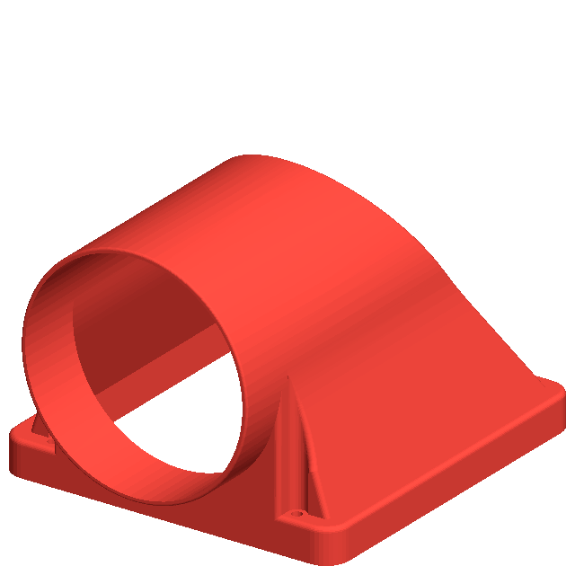
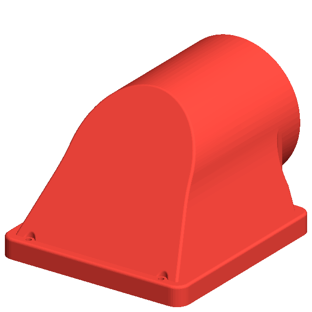
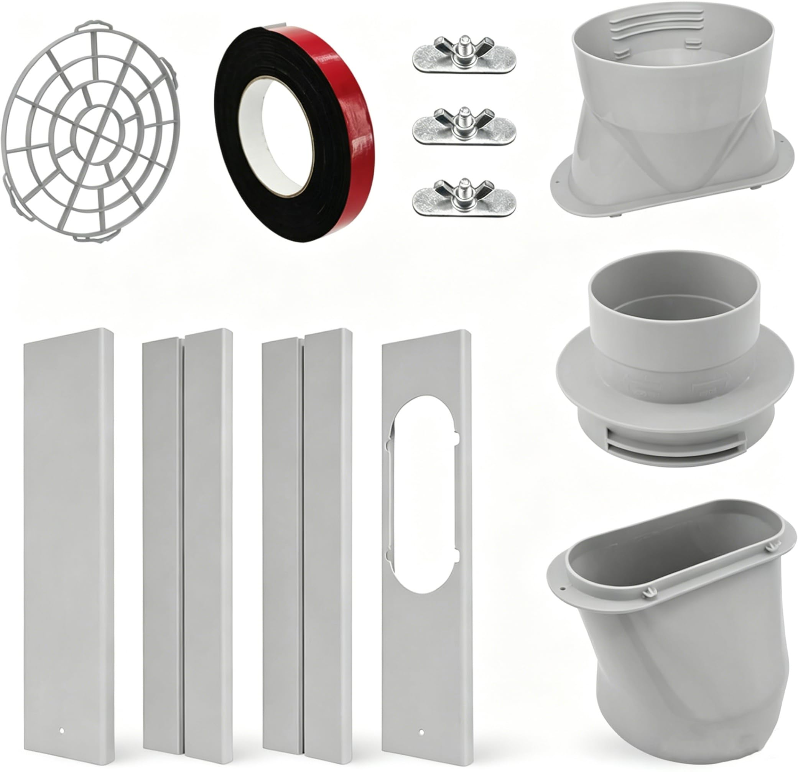
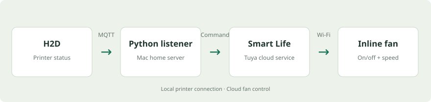
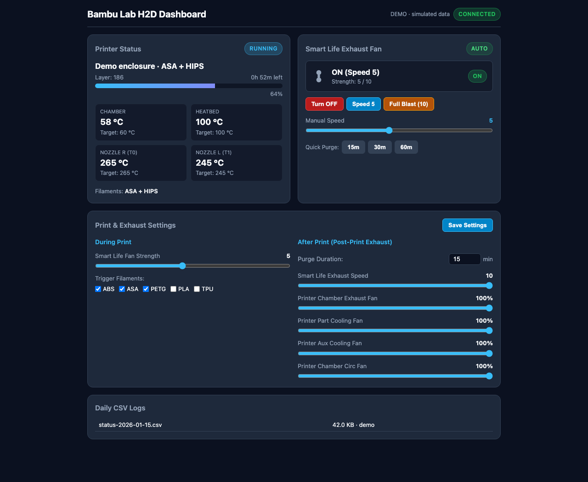
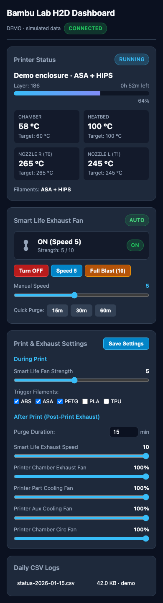

# How I connected my H2D to a Smart Life exhaust fan

*Daniel Yakobian · October 20, 2026*

I wanted to connect my Bambu Lab H2D to a window exhaust and have an external fan follow the print. But the main question came before the automation: with the printer's exhaust closed during printing, would the external fan still pull air from inside the printer?

The result is a small Python service on a Mac, a connection to the printer's local status feed, and a web dashboard.

## Would it pull air with the exhaust closed?

This was the main issue I was trying to figure out. The H2D's exhaust flap was closed during printing, and I wasn't sure whether an inline fan connected to the rear exhaust could still draw air out of the printer in that state.

In my setup, the answer was yes. The external fan still pulled air from the printer while it was printing, even with the exhaust flap closed. That was the finding that made running the external fan during a print useful, instead of only using it for a purge afterward.

Getting there involved checking how the printer's vents behaved. I tested the H2D's cooling and heating modes and the Filter switch. The top vent and rear flap moved together with the printer's exhaust setting, and the Filter switch didn't give me an independent way to leave the rear open and the top closed.

The practical answer was that I didn't need the rear flap held open for the external fan to pull air during printing. I haven't measured the airflow rate or room air quality, so this confirms that air is being drawn out in my setup, not how much.

Once that question was settled, the next job was making the fan follow the printer: let the chamber warm up, run the fan during the print, then keep it going for a purge at the end. I also wanted to change its speed without digging through the Smart Life app.

## Printing the exhaust adapter

For the printer end of the duct, I used [Robert G's H2-series 4-inch exhaust adapter on Printables](https://www.printables.com/model/1517742-bambu-lab-h2-series-4-inch-exhaust-duct-adapter-h2). It connects the rear exhaust port to a standard 4-inch duct, with the outlet facing either left or right. The download also includes a version sized for an optional TPU gasket.





*Two views of the adapter model, not photographs of my installation. Design by Robert G, shared as public domain on Printables. The red is just the render color.*

The designer recommends PETG and organic supports. I printed mine on the H2D in Creality Hyper ABS, using HIPS only for the support layers that touch the part. ABS ran through the right nozzle and HIPS through the left, so the bulk of the supports could stay ABS.

The print finished on October 13 after 8 hours and 28 minutes, including the end routine. The supports came off very easily, but the supported underside was rough with a 0.2 mm top support gap. My next adjustment is to try 0.1 mm; I haven't verified that change yet.

## A window kit for the other end

For the window end, I bought this [LEZIFU adjustable window vent kit from Amazon](https://www.amazon.com/dp/B0GVPBDBRT). The listing covers 4-, 5-, and 6-inch ducting and describes a 17–60-inch range for sliding windows. The 4-inch option matches the nominal size of the printer adapter and inline fan.



*Product photo from the Amazon listing for the kit I purchased. This shows the supplied parts, not my installed window.*

The kit provides adjustable panels for the window opening and a duct connection through one panel. That gave me a ready-made window outlet to pair with the printed printer adapter, rather than making a custom window panel as well. Those parts define the exhaust route; they don't establish how much air the finished setup moves.

## An old Mac became the bridge

I already had a Mac running as a home server, so I used it to connect the two systems.

The H2D publishes status through its local MQTT connection. My Python listener reads that feed, keeps track of the current job and temperatures, and decides when the external fan should run. A separate adapter sends the fan commands through Smart Life's Tuya service.



The printer connection stays on the local network. The Smart Life side uses the cloud, so it still depends on that service and the internet connection.

For the fan sign-in, I used Tuya's SDK and its QR-code flow. The adapter finds the fan's on/off and speed controls rather than assuming every Smart Life device uses the same settings. The account tokens stay in local configuration files.

## The warm-up delay was worth adding

The first version focused on ABS and ASA. I tried different speeds, then settled on strength 5 and added PETG to the list.

I also changed when the fan starts. Turning it on as soon as a job appears can work against heating the chamber. The listener now waits until the printer is actually printing or the chamber has reached a nonzero target temperature.

A target of zero doesn't count as “warmed up.” That small check matters when a status update arrives without an active chamber target.

## The purge and the phone notification

I wanted a stronger purge at the end, so the external fan now runs at strength 10 for a 15-minute purge. The listener recognizes the printer's air-purification stage as well as the job ending.

I also added printer-side end G-code for a purge. That's a separate part of my setup. This repository's Python service requests status from the H2D; it doesn't send printer fan commands, move the toolhead or change temperatures.

At one point I thought the fans hadn't gone to full speed because they were off when the “print finished” notification reached my phone. Looking at the logs showed that the purge had already run before the notification arrived. The alert was a poor reference point for checking when the purge started.

## Then I wanted a dashboard

Once the automation was running, I wanted to see what it was doing and override it when needed.

The dashboard shows the current job, progress, remaining time, chamber temperature, bed temperature and both nozzle temperatures. Alongside that are the external fan's state and speed, manual controls, timed purges and a return-to-auto button.



*The screenshots use the built-in demo with fictional job names and temperatures.*

I can also change the fan strength, trigger materials and purge duration from the page. Those settings survive a restart. The printer-fan percentages shown in the settings panel are stored values; they don't make the Python listener send commands to the printer.

On a phone, the same page stacks into a single column.



## Making it survive ordinary failures

I didn't want a dropped connection or a restarted process to lose track of the fan. The service reconnects to the printer, preserves its tracked fan job and purge state, and retries failed fan commands.

It also writes daily CSV logs. Those were useful when I needed to compare the print stages, fan activity and notification timing.

The test suite uses a fake TLS printer and temporary files. Its 39 tests cover MQTT handling, partial updates, reconnects, logging, web routes and fan behavior without using the real printer credentials.

## Try it without connecting anything

The repository includes a demo that runs entirely on fictional data:

```sh
python3 scripts/demo.py
```

Open http://localhost:8792. The demo's buttons change simulated state only.

For the real setup, see [the installation instructions](SETUP.md) and [the source code](https://github.com/danielyaa5/h2d-custom-dashboard).

The dashboard has no login and its fan controls can operate real hardware. I keep it on my trusted home network rather than publishing the control panel on the internet. This page is the build story, not access to my printer.
